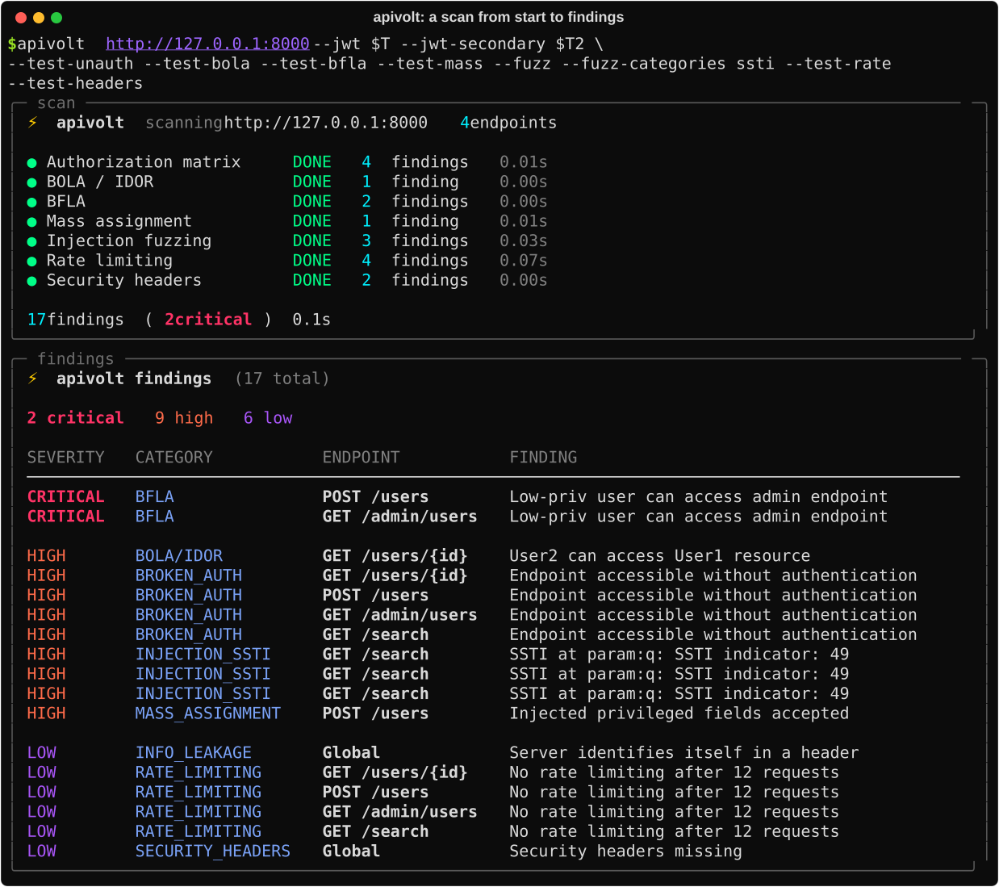

# APIvolt

Spec-driven API security testing from the command line. APIvolt reads an API
definition (OpenAPI/Swagger or a Postman collection), parses every endpoint,
and runs authorization, authentication and injection test modules against a
target you are authorized to test. Think of it as a spec-first, CLI-first
complement to an interactive proxy.



*A single run against the deliberately vulnerable demo API in `demo/vulnerable-api/`, on loopback: the scan panel, then the findings report.*

## What it tests

APIvolt ships eleven test modules:

| Module | Flag | Finds |
|---|---|---|
| Authorization matrix | `--test-unauth` | endpoints that require auth in the spec but answer without it |
| BOLA / IDOR | `--test-bola` | one user reaching another user's object by id |
| BFLA | `--test-bfla` | a low-privilege user reaching admin or write endpoints |
| Method tampering | `--test-method` | undocumented HTTP methods that still succeed |
| Mass assignment | `--test-mass` | injected fields (role, is_admin, ...) accepted and reflected; sensitive data in responses |
| JWT manipulation | `--test-jwt` | alg:none, signature stripping, claim/role tampering, forged exp, kid injection |
| Content-Type confusion | `--test-ctype` | parser confusion across alternate content types, XXE surface |
| Schema validation | `--test-schema` | responses that drift from the spec |
| Rate limiting | `--test-rate` | missing throttling under a burst |
| Security headers | `--test-headers` | missing security headers, wildcard CORS, info-leak headers |
| Injection fuzzing | `--fuzz` | SQLi, XSS, SSTI, path traversal and command-injection signals |

It also converts Postman collections to OpenAPI, and writes its findings as
JSON, Markdown or a self-contained HTML report.

## Install

```sh
python3 -m venv .venv && . .venv/bin/activate
python -m pip install .
apivolt --help
```

Requires Python 3.10+ and two dependencies (`requests`, `PyYAML`). APIvolt is a
single module; you can also run it in place with `python3 apivolt.py`.

## Quickstart against the bundled demo

The repository ships a deliberately vulnerable API so you can see APIvolt work
end to end. In one terminal:

```sh
python3 demo/vulnerable-api/server.py        # binds 127.0.0.1:8000, serves /openapi.json
```

In another:

```sh
# auto-discover the spec and list endpoints
apivolt http://127.0.0.1:8000 --endpoints

# run every module (two tokens let BOLA/BFLA compare users)
T=$(python3 -c "import apivolt;print(apivolt.JWTUtils.encode_unsigned({'alg':'HS256','typ':'JWT'},{'sub':'1','role':'user'}))")
T2=$(python3 -c "import apivolt;print(apivolt.JWTUtils.encode_unsigned({'alg':'HS256','typ':'JWT'},{'sub':'2','role':'user'}))")
apivolt http://127.0.0.1:8000 --jwt "$T" --jwt-secondary "$T2" --test-all --report-json findings.json
```

See `demo/vulnerable-api/README.md` for the full list of planted flaws and the
module that catches each one.

## Usage

```sh
apivolt <target> [options]
```

`<target>` is a live base URL (APIvolt probes common spec paths such as
`/openapi.json` and `/swagger.json`), a direct spec URL, a local OpenAPI
file, or a Postman collection with `--from-postman`.

Common options (run `apivolt --help` for the full list):

| Option | Purpose |
|---|---|
| `-b, --base-url URL` | base URL when the input is a local spec file |
| `--from-postman` | treat the input as a Postman collection |
| `--jwt` / `--jwt-secondary` | primary and second bearer tokens (the second enables BOLA/BFLA) |
| `--api-key`, `--cookie-auth`, `--basic-auth` | other auth modes |
| `--proxy` / `--proxy-url` | route through a proxy (`--proxy` uses 127.0.0.1:8080) |
| `--tags` / `--methods` | restrict testing to matching endpoints |
| `--test-all` | run every module |
| `--report-json FILE` | write findings as JSON |
| `--report-all DIR` | write JSON, Markdown and HTML reports into DIR |
| `--report-md FILE` | write a Markdown findings report |
| `--report-html FILE` | write a self-contained HTML findings report |
| `--to-openapi FILE` | convert a Postman collection to OpenAPI and exit |
| `--delay`, `--timeout` | pace and bound requests |

## Reports

Beyond the terminal panel, APIvolt writes the same findings to file in three
formats, keeping the full title and detail of each finding:

```sh
apivolt http://127.0.0.1:8000 --jwt "$T" --jwt-secondary "$T2" --test-all \
  --report-json findings.json --report-md report.md --report-html report.html
```

Or write all three at once into a directory:

```sh
apivolt http://127.0.0.1:8000 --jwt "$T" --jwt-secondary "$T2" --test-all --report-all out/
```

The HTML report is self-contained (no external requests) and safe to open or
share; hostile values from a target are escaped.

## Authorization

**Use APIvolt only against systems you are explicitly authorized to test:** a
bug-bounty program whose scope and rules permit automated testing, a
penetration-test engagement, a CTF, or infrastructure you own. The modules send
active requests, including forged tokens, injection payloads and bursts, and can
create or modify data through write endpoints.

Confirm scope, rate limits and the testing window before you run it, and prefer
`--tags`/`--methods` and `--delay` to stay within them.

APIvolt does not evade WAFs, CAPTCHAs or rate limiting, and does not brute-force
credentials.

## Tests

```sh
python -m pip install '.[dev]'
pytest -q
```

The suite is offline: unit tests cover the JWT utilities, the Postman
converter and spec parsing, and integration tests run each module against the
bundled demo server on a loopback ephemeral port. No test reaches the network.

## Known limits

- Injection fuzzing is signal-based (error strings, reflection, timing,
  template evaluation). Treat every result as a lead to confirm by hand, not a
  proven vulnerability.
- Schema and content-type checks can produce false positives on APIs whose
  responses legitimately vary from the spec.
- BOLA and BFLA need two accounts of the right relationship to be conclusive;
  a single token only exercises part of each check.
- Interactive mode uses Unix terminal APIs, so it targets Linux and macOS.

## License

Apache License 2.0. See [LICENSE](LICENSE).
